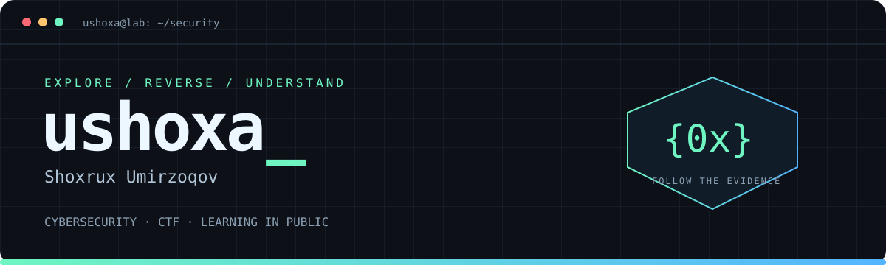

<div align="center">



### Break it down. Figure it out. Write it up.

Cybersecurity enthusiast & CTF player from **Samarkand, Uzbekistan** · **Fr4ctur3 (Only_AI)**

[](https://www.linkedin.com/in/ushoxa/)
[](https://t.me/ushoxa)
[](https://www.instagram.com/vipshoxa/)

[CTF writeups](https://github.com/ushoxa/HI-Cyber-Con-2026-CTF) · [Challenge checklist](https://github.com/ushoxa/HI-Cyber-Con-2026-CTF/blob/main/CHECKLIST.md) · [Projects](https://github.com/ushoxa?tab=repositories)

</div>

## `$ whoami`

I'm **Shoxrux Umirzoqov**, known online as **ushoxa**. I learn cybersecurity by working through challenges, investigating how systems behave, and documenting the path from a clue to a reproducible solution.

My GitHub is where I share CTF writeups, solver scripts, and the lessons behind them. I enjoy the point where a strange file, a packet capture, or an unexpected response starts to make sense.

```text
┌─[ ushoxa@lab ]
├─ focus     cybersecurity & capture the flag
├─ team      Fr4ctur3 / Only_AI
├─ approach  inspect → question → test → document
└─ goal      understand the system, then share the reasoning
```

## 🥈 A result I'm proud of

### HI Cyber Con 2026 CTF — 2nd place

Our team **Fr4ctur3 (Only_AI)** finished **2nd out of 1,119 teams**. We're collecting our writeups and supporting files so others can explore the challenges and learn alongside us.

<a href="https://github.com/ushoxa/HI-Cyber-Con-2026-CTF"></a>

| Explore | What you'll find |
| :--- | :--- |
| [Web & application security](https://github.com/ushoxa/HI-Cyber-Con-2026-CTF/tree/main/Web) | Challenge behavior, exploitation paths, and implementation details |
| [Reverse engineering](https://github.com/ushoxa/HI-Cyber-Con-2026-CTF/tree/main/Reverse%20Engineering) | Binary analysis, custom formats, and reconstructed logic |
| [Digital forensics](https://github.com/ushoxa/HI-Cyber-Con-2026-CTF/tree/main/Forensics) | Memory, artifacts, and evidence-driven investigation |
| [Cryptography](https://github.com/ushoxa/HI-Cyber-Con-2026-CTF/tree/main/Cryptography) | Encodings, key recovery, and cryptographic implementation lessons |
| [Network analysis](https://github.com/ushoxa/HI-Cyber-Con-2026-CTF/tree/main/network) | Packet captures, protocol details, and recovered data |
| [OSINT](https://github.com/ushoxa/HI-Cyber-Con-2026-CTF/tree/main/OSINT) | Public-source research and geolocation challenges |

## 🔎 A few writeups to start with

- [**Snapfile**](https://github.com/ushoxa/HI-Cyber-Con-2026-CTF/blob/main/Reverse%20Engineering/Snapfile/Snapfile.md) — reconstructing a binary container accepted by a custom parser.
- [**Cipher**](https://github.com/ushoxa/HI-Cyber-Con-2026-CTF/blob/main/android/Cipher/Cipher.md) — tracing an Android vault's passphrase generation and authenticated decryption.
- [**Pruned Ledger**](https://github.com/ushoxa/HI-Cyber-Con-2026-CTF/blob/main/Blockchain/Pruned%20Ledger/Pruned%20Ledger.md) — recovering cleared state from blockchain transaction history.
- [**The Quiet Divide**](https://github.com/ushoxa/HI-Cyber-Con-2026-CTF/blob/main/network/The%20Quiet%20Divide/The%20Quiet%20Divide.md) — following a packet capture's evidence chain to an authenticated artifact.

## 🧰 In the lab


Currently turning competition notes into clearer writeups, building reproducible examples, and exploring the connections between forensics, reverse engineering, and cryptography.

## 🌐 Beyond the flags

I also work on [**I2A**](https://github.com/ushoxa/I2A), a club website. You can visit it at [**i2a.uz**](http://i2a.uz/).

Want to discuss a challenge, compare approaches, or share a useful resource? Find me on [Telegram](https://t.me/ushoxa) or [LinkedIn](https://www.linkedin.com/in/ushoxa/).

---

<div align="center">
<sub>Curiosity is the starting point. Evidence is the way forward.</sub>
</div>
